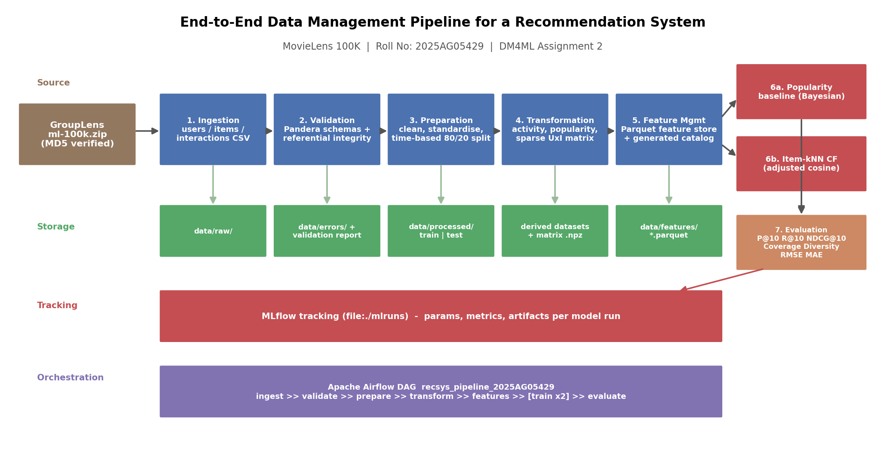

# End-to-End Data Management Pipeline for a Recommendation System

**Roll No: 2025AG05429 | DM4ML Assignment 2**
Student: SUTARIYA PARTH POPATBHAI · Course: Data Management for Machine Learning (AIMLZG529)

A fully reproducible movie-recommendation pipeline on **MovieLens 100K**:

```
Data Ingestion → Data Validation → Data Preparation → Data Transformation →
Feature Management → Model Training → Model Evaluation → Orchestration
```



## What each stage does

| # | Stage | Module | Key outputs |
|---|-------|--------|-------------|
| 1 | Ingestion | `src/ingestion/ingest.py` | Downloads `ml-100k.zip` from GroupLens, **verifies MD5**, writes canonical `users / items / interactions` CSVs to `data/raw/` |
| 2 | Validation | `src/validation/validate.py` | **Pandera** schemas + custom checks: missing values, dtypes, duplicate keys, rating ∈ [1,5], timestamp range, **referential integrity**. Bad rows → `data/errors/*_errors.csv` with reasons; report → `reports/validation_report.{json,md}` |
| 3 | Preparation | `src/preparation/prepare.py` | Cleaning, format standardisation, re-rating dedup (keep latest), **time-based 80/20 train/test split** |
| 4 | Transformation | `src/transformation/transform.py` | User activity summary, item popularity (Bayesian mean), **sparse user×item matrix** (`.npz`) — train window only |
| 5 | Feature management | `src/features/build_features.py` + `store.py` | 24 documented user/item/interaction features in a **Parquet feature store**; catalog table generated from code → `reports/feature_catalog.md` |
| 6 | Training | `src/training/train.py`, `models.py` | **Popularity baseline** (ranks by feature-store Bayesian rating) and **Item-kNN collaborative filtering** (adjusted cosine, shrinkage, top-k pruning). Params/metrics/artifacts tracked in **MLflow** |
| 7 | Evaluation | `src/evaluation/evaluate.py`, `metrics.py` | Precision@10, Recall@10, NDCG@10, Coverage, Diversity + RMSE/MAE; comparison table → `reports/evaluation/model_comparison.md` |
| 8 | Orchestration | `dags/recsys_pipeline_dag.py` | **Apache Airflow** DAG (`airflow standalone`, BashOperator per stage, parallel model training); `src/pipeline.py` is a one-command fallback runner |

## Quick start (fresh Ubuntu 22.04/24.04)

Prerequisites: `python3` ≥ 3.10 with `venv` (`sudo apt install -y python3-venv` if missing) and internet access.

```bash
git clone https://github.com/parth1216/dm4ml-recommendation-pipeline.git
cd recommendation-pipeline

# 1. environment (pinned deps, ~2 min)
bash scripts/setup.sh

# 2. full pipeline end-to-end + unit tests (~2 min)
bash scripts/run_pipeline.sh
```

That is all — every artifact (validation report, feature store, models, evaluation
tables, MLflow runs) is regenerated from scratch, deterministically.

### Inspect MLflow experiment tracking

```bash
.venv/bin/mlflow ui --backend-store-uri file:./mlruns --port 5000
# open http://localhost:5000  →  experiment "dm4ml_a2_recsys"
```

### Run with Apache Airflow (as in the lab session)

```bash
bash scripts/setup_airflow.sh          # installs Airflow 2.10.5 in .venv-airflow, starts standalone
# UI: http://localhost:8080  (user: admin, password: .airflow/standalone_admin_password.txt)
# Enable + trigger DAG: recsys_pipeline_2025AG05429
```

Airflow lives in its **own virtualenv** and its tasks execute the stage modules
inside the project venv (BashOperator) — the same isolation pattern used in
production deployments, and the DAG handles dependencies incl. parallel
training of both models.

CLI alternative (no browser needed):

```bash
export AIRFLOW_HOME=$PWD/.airflow RECSYS_PROJECT_ROOT=$PWD RECSYS_VENV_PY=$PWD/.venv/bin/python
.venv-airflow/bin/airflow dags test recsys_pipeline_2025AG05429
```

## Results (regenerated by every run)

See `reports/evaluation/model_comparison.md`. Summary of the committed run:
the personalised **item-kNN CF beats the popularity baseline on Precision@10,
NDCG@10, catalog coverage, RMSE and MAE**; the baseline keeps Recall@10
because the chronological test window is dominated by widely-watched
blockbusters, which a popularity list retrieves by construction — the
trade-off is analysed in the final report.

## Repository layout

```
recommendation-pipeline/
├── data/            raw | processed | features | errors   (regenerated; errors committed as evidence)
├── src/             ingestion | validation | preparation | transformation | features | training | evaluation
├── dags/            recsys_pipeline_dag.py (Airflow)
├── configs/         pipeline.yaml  — single source of truth for paths & hyper-parameters
├── models/          <model>/metadata.json (+ model.joblib, regenerated)
├── reports/         validation report, feature catalog, evaluation tables, figures, final report PDF
├── scripts/         setup.sh | run_pipeline.sh | setup_airflow.sh
├── tests/           unit tests for validation quarantine, metrics and models
├── requirements.txt pinned versions
└── README.md
```

## Design decisions (details in `reports/DM4ML_Assignment2_Report.pdf`)

* **Time-based split** (global timestamp quantile) instead of a random split —
  evaluating on the future, as production would.
* **Features are computed on the train window only**, "as of" the last train
  timestamp, and served from one feature store for both training and
  prediction — no leakage, no train/serve skew.
* **Bayesian damped mean** for popularity so 5-star-once movies don't top the chart.
* **Quarantine, don't drop silently**: every rejected record lands in
  `data/errors/` with an `error_reasons` column.
* **Everything is config-driven** (`configs/pipeline.yaml`) and every stage is
  idempotent — re-running any stage overwrites its own outputs only.

## Reproducibility checklist

* Pinned `requirements.txt`; dataset checksum pinned & verified at ingest.
* `random_seed` in config (the pipeline is deterministic end-to-end anyway).
* One-command setup + one-command run; unit tests via `pytest tests/ -q`.
* Airflow DAG and the fallback runner call identical stage entry points.
